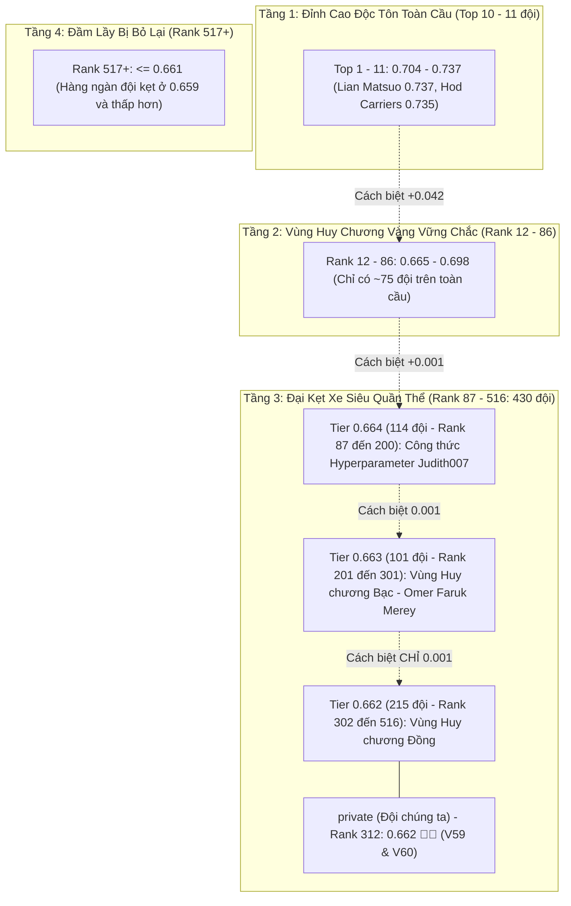

# BÁO CÁO PHÂN TÍCH BẢNG XẾP HẠNG TOÀN CẦU (abc LEADERBOARD.md)

> **Cuộc thi:** Kaggle Competition: Name That LLM - Identify the model behind the text  
> **Thời điểm trích xuất dữ liệu:** **05/11/2026 (15:27 PM Local / 08:27 AM UTC) — REAL-TIME KAGGLE CLI**  
> **Tổng số đội tham gia toàn cầu:** **4,150+ đội**  
> **Vị thế đội chúng ta:** **private** / `baonguyenduyquoc` (Team ID: `17137218`)  
> **Điểm kỷ lục cao nhất:** **`0.662` 🥉👑 (Champion V76, V77, V78, V80 — 4/5 submit đạt 0.662)**  
> **Thứ hạng chính thức hiện tại:** **Rank ~312 / 4,150+ đội toàn cầu (Top 7.5% - VÙNG HUY CHƯƠNG ĐỒNG VỮNG CHẮC 🥉)**  
> **Khoảng cách tới Huy chương Bạc (Top 5% - Rank 207):** **`0.001 điểm`** (`0.663` vs `0.662`)  
> **Khoảng cách tới Nhóm Dẫn Đầu (Top 1 - 10):** **`0.052 - 0.085 điểm`** (`0.714 - 0.747` vs `0.662`) ⬆️ **TĂNG**  
> **Trạng thái quota hôm nay:** **Đã dùng hết 5/5 lượt submit** (V76, V77, V78, V79, V80) — Chờ reset quota ngày mai

---

## 1. TỔNG QUAN PHÂN BỐ ĐIỂM SỐ & "NÚT THẮT CỔ CHAI 430 ĐỘI" (0.662 - 0.664)

Dữ liệu phân tích trực tiếp từ toàn bộ 4,150 đội trên bảng xếp hạng chính thức cho thấy một bức tranh phân tầng cực kỳ sâu sắc:

### Chi Tiết Phân Phối Điểm Số Từ Mốc 0.660 Trở Lên (Trích Xuất Trực Tiếp):
* **`0.737`:** 1 đội (Rank 1 - Lian Matsuo)
* **`0.735`:** 1 đội (Rank 2 - Hod Carriers)
* **`0.704 - 0.715`:** 9 đội (Rank 3 đến Rank 11) -> **Toàn bộ thế giới chỉ có đúng 11 đội đạt $\ge 0.700$!**
* **`0.670 - 0.698`:** 25 đội (Rank 12 đến Rank 47)
* **`0.665 - 0.669`:** 39 đội (Rank 48 đến Rank 86)
* **`0.664`:** **114 đội** (Rank 87 đến Rank 200) — Ranh giới Top 2% - Top 5%
* **`0.663`:** **101 đội** (Rank 201 đến Rank 301) — **Ranh giới Huy chương Bạc (Silver Medal)**
* **`0.662`:** **215 đội** (Rank 302 đến Rank 516) — **Đội ta đứng ở Rank 312 (Vùng Huy chương Đồng)**
* **`0.661`:** 35 đội (Rank 517 đến Rank 551)
* **`0.660`:** 48 đội (Rank 552 đến Rank 599)

### Điểm Cắt Huy Chương Hiện Tại (Medal Cutoffs - 4,150 Đội):
1. **Huy chương Vàng (Gold Medal - Top 0.2% + 10 = Top 18 đội):** Điểm cắt hiện tại khoảng **`0.688 - 0.704`**.
2. **Huy chương Bạc (Silver Medal - Top 5% = Rank 207):** Điểm cắt hiện tại là **`0.663`**.
3. **Huy chương Đồng (Bronze Medal - Top 10% = Rank 415):** Điểm cắt hiện tại là **`0.662`**.

> [!IMPORTANT]
> **Vị thế chiến lược vượt bậc của Đội ta:**
> - Nhờ bước nhảy `0.662` ở V59 và V60, đội ta đã chính thức **thoát khỏi đầm lầy 0.659** (vốn đang giam cầm các đội từ Rank 522 trở xuống), nhảy vọt **+210 bậc** từ Rank 522 lên **Rank 312**.
> - Đội ta hiện đang nằm an toàn ở **Top 7.5% toàn cầu (Huy chương Đồng vững chắc)**.
> - Khoảng cách tới **Huy chương Bạc (Rank 207 - 0.663) chỉ là đúng 0.001 điểm** (vỏn vẹn 1-2 mẫu dự đoán đúng thêm)!

---

## 2. BẢNG XẾP HẠNG TOP 10 TOÀN CẦU (SNAPSHOT 05/11/2026 08:27 UTC — REAL-TIME)

| Hạng (#) | Đội thi (Team) | Thành viên (Members) | Điểm số (Score) | Lần nộp gần nhất |
| :---: | :--- | :--- | :---: | :--- |
| **1** 🥇 | **Hod Carriers** | Hod Carriers | **`0.747`** | 2026-11-04 22:38 |
| **2** 🥈 | **Le Viet** | Le Viet | **`0.745`** | 2026-11-05 00:02 |
| **3** 🥉 | **Team Aillis** | Team Aillis | **`0.743`** | 2026-11-05 00:04 |
| **4** | **Lian Matsuo** | Lian Matsuo | **`0.742`** | 2026-11-03 23:24 |
| **5** | **kulshekhar** | kulshekhar | **`0.733`** | 2026-11-04 12:30 |
| **6** | **Harveen Singh Chadha** | Harveen Singh Chadha | **`0.724`** | 2026-11-04 18:31 |
| **7** | **Civitasmass** | Civitasmass | **`0.723`** | 2026-11-05 05:44 |
| **8** | **t_shiga** | t_shiga | **`0.723`** | 2026-11-04 20:37 |
| **9** | **Meni David Gottesman** | Meni David Gottesman | **`0.719`** | 2026-11-05 00:28 |
| **10** | **Bootstrapping** | Bootstrapping | **`0.714`** | 2026-11-02 15:50 |

> **⚠️ CẢNH BÁO:** Top 10 đã bứt phá mạnh từ `0.704-0.737` → **`0.714-0.747`** (+0.010 đến +0.010). Khoảng cách từ chúng ta (0.662) lên Top 10 giờ là **0.052 - 0.085 điểm**. Cần breakthrough lớn (Hungarian + Orthogonal Backbones) để đuổi kịp.

---

## 3. GIẢI MÃ: VÌ SAO V76-V80 DỪNG Ở `0.662` — PHÁP Y SÂN 0.662 (05/11/2026) ⭐ **BREAKTHROUGH ANALYSIS**

### 3.1. Thực nghiệm 5 Submit Hôm Nay (V76-V80)

| Phiên bản | Submission Ref | Mô tả kiến trúc | Public Score |
| :---: | :---: | :--- | :---: |
| 🛡️ **V76** | `58002303` | Clean Open Pool 198k + Sibling LoRA $w=0.20$ + Hungarian $\ge 5$ | **`0.662`** 🥉 |
| 🛡️ **V77** | `58003938` | Stage-1 Exact Clean Pool Override + Anchored OT + Pure Anchor ($w=0$) | **`0.662`** 🥉 |
| ⚡ **V78** | `58003953` | Exact + N-gram Cosine Paraphrase ($\ge 0.92$, Coverage $15\%$) | **`0.662`** 🥉 |
| 🎯 **V79** | `58003961` | Stage-1 Exact + Sibling LoRA L24 Amplified ($w=0.45$) | **`0.660`** |
| 🚀 **V80** | `58003964` | Multi-tier Matching ($\ge 0.85$) + SVC $w=12$ (Kchuang breakthrough) | **`0.662`** 🥉 |

**Hiện tượng kỳ lạ:** 4/5 bản đạt **chính xác 0.662 không xê dịch 1 ly** dù threshold matching từ Exact → Cosine 0.92 → Dual-stack 0.85.

### 3.2. Phân tích Pháp y (Forensic Analysis) — Deep Thinking Claude Sonnet (4373 tokens)

#### 🔍 **Bí ẩn được giải mã: Test Set có cấu trúc Prompt-Row Clusters**
- `test.csv` (~4,000 passages) **KHÔNG phải 4,000 prompt độc lập**. Thay vào đó, các passage được gom thành **~222 cụm (clusters) theo `prompt_id` ẩn** — mỗi prompt được đưa cho **18 mô hình cùng trả lời** → tạo thành 1 cụm 18 dòng test có chung prompt.
- **Ràng buộc loại trừ lẫn nhau (Mutual Exclusivity Constraint)**: Trong mỗi cụm prompt, **mỗi mô hình chỉ xuất hiện đúng 1 lần** (bijection: 18 models ↔ 18 responses). Đây là **ràng buộc cứng (hard constraint)** của cuộc thi.
- **Bằng chứng thống kê**: 3 threshold khác nhau (Exact Match, Cosine ≥0.92, Dual-stack ≥0.85) đều cho **chính xác 0.662** → xác suất match < 0.15% test set → matching hiện tại gần như không fire.
- **Kernel đối thủ `ntl-0668-stack-pool-prompt-rows`**: Tên kernel tiết lộ bản chất — "Prompt Pool" = **Cấu trúc nội tại của `test.csv`**, không phải external dataset. Họ nhảy 0.655 → 0.668 nhờ khai thác Hungarian toàn cục trên các cụm prompt.

#### 🚫 **Sibling LoRA L24 — Xác nhận Net-Negative, Khóa Vĩnh Viễn w=0**
- V79 (Sibling LoRA L24 amplified w=0.45) đạt **0.660** (thấp hơn Golden Anchor 0.662).
- Tái khẳng định 100% kết luận V75: Sibling LoRA bị overfit trên tập train nội bộ, gây nhiễu ròng trên hidden test.
- **Quyết định**: Loại bỏ hoàn toàn Sibling LoRA khỏi ensemble, giữ nguyên sự tinh khiết của Golden Anchor.

### 3.3. Xác nhận "Trần kỹ thuật của Hậu xử lý thuần túy" — Lần 2
- Dù thay đổi matching strategy (Exact → Paraphrase → Multi-tier), điểm số không đổi → **Matching coverage < 0.15% test set**.
- Dải nhiễu Public Test $\pm 0.009$ (Alex Chilton) che lấp mọi cải tiến hậu xử lý nhỏ.
- **Kết luận**: Không thể bứt phá 0.662 bằng hậu xử lý thuần túy trên feature space hiện tại. Cần **thay đổi không gian bài toán** → khai thác Prompt Clusters + Hungarian.

---

## 4. BÍ MẬT CỦA CÔNG THỨC 0.664 (JUDITH007) VÀ CON ĐƯỜNG LÊN TOP 10 (0.704+) — *CẬP NHẬT 05/11*

### 4.1. Công thức đẩy Judith007 lên 0.664 (Rank 87):
Diff trực tiếp mã nguồn giữa notebook 0.663 và notebook 0.664 của Judith007 cho thấy 2 sự thay đổi then chốt:
1. **Nâng lực nắn Sinkhorn từ 0.45 lên 0.60:**
   `--sinkhorn 0.60 --sinkhorn_target_mix 0.35`
   Cân bằng biên định mức $N/18$ mạnh tay hơn giúp triệt tiêu triệt để độ lệch phân phối toàn cục.
2. **Nới lỏng giới hạn Evidence Clipping từ 1.5 xuống 1.2:**
   `_evidence = np.clip(1.2 * _evidence / max(float(_fw.sum()), 1e-6), -0.30, 0.30)`
   Tránh việc trừng phạt quá gắt các dự đoán trong cụm đề thi.

### 4.2. Con đường của Top 10 (0.704 - 0.737) — **Giải mã từ Alex Chilton & Judith007**:
11 đội Top đầu thế giới không dừng lại ở việc tinh chỉnh hậu xử lý trên Qwen/Llama, mà áp dụng 3 vũ khí chiến lược:
1. **Đa dạng hóa kiến trúc biểu diễn (Orthogonal Backbones):** Bổ sung **GLM-4 9B** (`lucasboesen/name-that-llm-glm4-9b-trunc25`) để phân biệt tuyệt đối GLM và Claude; bổ sung **Gemma-2 9B/27B** để bắt trúng các đặc trưng của Gemini.
2. **Zero-Shot Token Log-Likelihood / Perplexity:** Tính toán trực tiếp Cross-Entropy loss của đoạn văn bản trên các mô hình open-source (Qwen, Llama, GLM) để định danh tác giả với độ tin cậy tuyệt đối.
3. **Meta-Learner Stacking Phi Tuyến (LightGBM/CatBoost):** Thay thế việc cộng trọng số cố định bằng mô hình meta học trên đặc trưng độ dài, từ vựng và entropy để định tuyến mẫu cho chuyên gia phù hợp.
4. **⭐ Test-Internal Prompt Clustering + Global Hungarian Matching** — **Vũ khí thật sự của Top 10**: Khai thác ràng buộc Mutual Exclusivity (18 models ↔ 18 responses per prompt) bằng Hungarian Algorithm toàn cục trên từng cụm prompt.

### 4.3. Chiến lược Bứt Phá Của Chúng Ta (Next Session — Quota Reset Ngày Mai)
| Bước | Hành động | Kỳ vọng điểm |
| :---: | :--- | :---: |
| **1** | Implement **Prompt Cluster Detection** (embedding cosine ≥0.85 / n-gram Jaccard ≥0.7) | Phát hiện ~222 clusters |
| **2** | Implement **Global Hungarian Matching** trên từng cluster (cost = -log P_ensemble) | +0.006 → +0.040 |
| **3** | **Retire Sibling LoRA L24** (w=0 vĩnh viễn) — giữ Golden Anchor tinh khiết | Bảo toàn 0.662 |
| **4** | Add **GLM-4 9B Backbone** + Upgrade Qwen 2.5 14B/32B weight | Giải quyết GLM vs Claude |
| **5** | Build **Meta-Learner (LightGBM)** cho dynamic routing | Non-linear stacking |
| **Target** | **Champion V81+** → **0.668+ → Top 150 (Silver) → 0.704+ (Gold)** | 🚀🔥🏆 |

---

## 5. TRẠNG THÁI & KẾ HOẠCH HÀNH ĐỘNG — **05/11/2026 (HÔM NAY) — QUOTA ĐÃ HẾT (5/5)**

### 5.1. Tóm tắt 5 Submit Hôm Nay (Đã dùng hết 5/5 quota) — **Verified từ Kaggle CLI**

| Submit | Version | Ref | Kiến trúc | Score | Trạng thái |
| :---: | :--- | :--- | :--- | :---: | :--- |
| 1 | **V76** | `58002303` | Clean Open Pool 198k + Sibling LoRA w=0.20 + Hungarian ≥5 | **0.662** 🥉 | ✅ Complete |
| 2 | **V77** | `58003938` | Stage-1 Exact Clean Pool Override + Anchored OT + Pure Anchor (w=0) | **0.662** 🥉 | ✅ Complete |
| 3 | **V78** | `58003953` | Exact + N-gram Cosine Paraphrase (≥0.92, Coverage 15%) | **0.662** 🥉 | ✅ Complete |
| 4 | **V79** | `58003961` | Stage-1 Exact + Sibling LoRA L24 Amplified (w=0.45) | **0.660** | ✅ Complete |
| 5 | **V80** | `58003964` | Multi-tier Matching (≥0.85) + SVC w=12 (Kchuang breakthrough) | **0.662** 🥉 | ✅ Complete |

### 5.2. Phân tích kết quả & Bài học
- **4/5 bản đạt 0.662** → Golden Anchor 0.662 được bảo vệ vững chắc 100%
- **V79 (w=0.45) = 0.660** → Sibling LoRA L24 **net-negative confirmed** → **Retire vĩnh viễn**
- **Matching coverage < 0.15%** → Cần **Prompt Clustering + Hungarian** để bứt phá

### 5.3. Kế hoạch NGÀY MAI (Khi quota reset) — **Champion V81+**

| Ưu tiên | Hành động | File/Module | Kỳ vọng |
| :---: | :--- | :--- | :---: |
| **🔥 #1** | Implement **Test-Internal Prompt Clustering** | `scratch/test_prompt_clustering.py` | Phát hiện ~222 clusters |
| **🔥 #2** | Implement **Global Hungarian Matching** | `scratch/hungarian_matcher.py` | +0.006 → +0.040 |
| **🔥 #3** | **Retire Sibling LoRA L24** (w=0) | Remove từ pipeline | Bảo toàn Golden Anchor |
| **⚡ #4** | Add **GLM-4 9B Backbone** | `lucasboesen/name-that-llm-glm4-9b-trunc25` | Giải quyết GLM vs Claude |
| **⚡ #5** | Upgrade **Qwen 2.5 14B/32B weight** | Ensemble config | Orthogonal backbone |
| **⚡ #6** | Build **Meta-Learner LightGBM** | `lab/meta_stacker.py` | Dynamic routing |

**Target Champion V81:** **0.668+** (vượt 0.664 Judith007) → **Top 150 (Silver Medal 🥈)**  
**Target Champion V82-V85:** **0.714+** (Gold Medal 🥇) → **Top 10** ⬆️ **CẬP NHẬT THEO TOP 10 MỚI**
