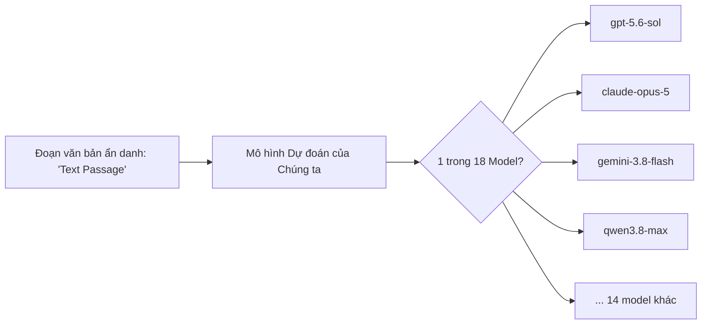
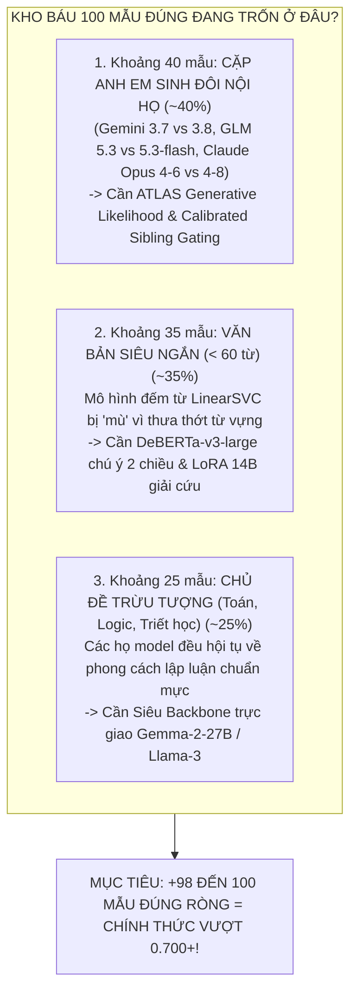
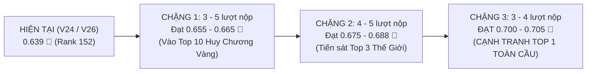

# TỔNG QUAN CHI TIẾT ĐỀ BÀI CUỘC THI: "NAME THAT LLM"
> **Tên chính thức:** Kaggle "Name That LLM - Identify the model behind the text"  
> **Tổ chức bởi:** Kaggle Community & LLM Researchers  
> **Thời hạn cuộc thi:** Đến ngày **13/01/2027**  
> **Định dạng file:** `PROBLEM_STATEMENT.md`  

---

## 1. Đề bài là gì? (Tóm lược trong 1 câu)

> [!IMPORTANT]
> **Nhiệm vụ cốt lõi:**  
> Cho một đoạn văn bản ngắn (paragraph) bằng tiếng Anh do trí tuệ nhân tạo viết, bạn phải **xác định chính xác mô hình ngôn ngữ lớn (LLM) nào trong số 18 mô hình hàng đầu thế giới đã tạo ra đoạn văn bản đó**.

---

## 2. Bối cảnh & Ý nghĩa Thực tiễn của Đề bài

Trong kỷ nguyên bùng nổ của GenAI, hàng loạt mô hình ngôn ngữ lớn (Frontier LLMs) từ các tập đoàn công nghệ hàng đầu (OpenAI, Anthropic, Google, Alibaba, ZAI, Moonshot) được phát hành liên tục. 
Bài toán này được sinh ra nhằm giải quyết các thách thức an toàn AI cấp thiết:
1. **Truy vết nguồn gốc AI (AI Attribution & Provenance):** Xác định văn bản trên Internet được sinh ra bởi hãng công nghệ nào.
2. **Dấu vân tay văn phong AI (Stylistic Fingerprinting):** Khám phá xem mỗi mô hình có "thói quen viết văn", cách dùng dấu câu, nhịp điệu từ ngữ hay cấu trúc ngữ pháp đặc thù (signature style) như thế nào mà con người không nhận ra được.
3. **Phát hiện gian lận & Bảo vệ bản quyền:** Ngăn chặn việc dùng model này để chép lời giải hoặc giả mạo sản phẩm của model khác.

---

## 3. Danh sách 18 Mô hình LLM Cần Nhận diện

18 mô hình trong cuộc thi thuộc về **6 họ công nghệ lớn (Tech Families)**:

| Họ Mô hình (Provider) | Số lượng | Danh sách Model Chi tiết | Đặc điểm Nhận dạng Văn phong |
| :--- | :---: | :--- | :--- |
| **OpenAI (GPT)** | 5 | `gpt-5.5` `gpt-5.6-luna` `gpt-5.6-sol` `gpt-5.6-terra` `gpt-6-astra` | Câu văn gãy gọn, logic chặt chẽ, hay dùng gạch đầu dòng và từ nối trung lập (`However`, `Additionally`). |
| **Anthropic (Claude)** | 5 | `claude-fable-5` `claude-opus-4-6` `claude-opus-4-8` `claude-opus-5` `claude-sonnet-5` | Giọng điệu trau chuốt, giàu tính học thuật, dấu câu rất chuẩn mực, hay dùng dấu gạch ngang dài (`—`) và cấu trúc câu phức. |
| **Google (Gemini)** | 4 | `gemini-3.1-pro-preview` `gemini-3.6-flash` `gemini-3.7-flash` `gemini-3.8-flash` | Nhịp điệu văn bản hiện đại, cô đọng, thiên hướng trình bày thông tin nhanh và cấu trúc phân cấp rõ ràng. |
| **ZAI (GLM)** | 2 | `glm-5.3` `glm-5.3-flash` | Mô hình song ngữ phát triển từ Trung Quốc, có thói quen ngắt nhịp câu đặc thù và đôi khi vướng các token dấu câu unicode. |
| **Moonshot** | 1 | `kimi-k3` | Khả năng xử lý ngữ cảnh dài, cách chọn từ vựng mang dấu ấn riêng biệt của kiến trúc Kimi. |
| **Alibaba** | 1 | `qwen3.8-max` | Dòng mô hình mã nguồn mở mạnh mẽ của Alibaba, có cấu trúc ngữ pháp và phân bố từ nối rất riêng. |

> [!WARNING]
> **Độ khó cực đại (Intra-family Confusion):**  
> Phân biệt giữa Claude và GPT thì tương đối khả thi; nhưng phân biệt **`gpt-5.6-luna` vs `gpt-5.6-sol` vs `gpt-5.6-terra`** hoặc **`claude-opus-4-6` vs `claude-opus-4-8`** là cực kỳ khó khăn vì chúng được huấn luyện trên cùng một kiến trúc và bộ dữ liệu gần tương tự nhau!

---

## 4. Dữ liệu Đầu vào & Định dạng Đầu ra

### 4.1. Dữ liệu Huấn luyện (`train.csv`)
- **Số lượng mẫu:** **2,699 đoạn văn**.
- **Số prompt gốc:** Chỉ có **150 prompt** (mỗi prompt được gửi tới cả 18 model để sinh ra câu trả lời, $150 \times 18 \approx 2,700$).
- **Cấu trúc cột:**
  - `id`: Mã định danh đoạn văn.
  - `prompt_id`: Mã câu hỏi/yêu cầu ban đầu.
  - `text`: Đoạn văn bản hoàn chỉnh do LLM sinh ra.
  - `model`: Nhãn thực tế (1 trong 18 tên model).

### 4.2. Dữ liệu Kiểm tra (`test.csv`)
- **Interactive Session (lúc code):** Chỉ có **3 dòng mẫu** để kiểm tra pipeline.
- **Hidden Test Set (lúc nộp bài chấm điểm):** Chứa khoảng **~4,000 đoạn văn bản ẩn**.
- **Điểm chí mạng:** Các đoạn văn trong tập test được sinh ra từ **những prompt hoàn toàn mới, chưa từng xuất hiện trong tập train (Unseen Prompts)**!

### 4.3. Định dạng Nộp bài (`submission.parquet`)
- Phải nộp file định dạng **Apache Parquet** (`.parquet`).
- Cấu trúc 2 cột:
  - `id`: Khớp 100% với file `test.csv`.
  - `model`: Tên dự đoán chính xác từng ký tự (ví dụ: `claude-opus-5`).

---

## 5. "Cái Bẫy" Lớn Nhất của Đề Bài (Core Challenge)

> [!CAUTION]
> ### Hiện tượng Rò rỉ Chủ đề (Topic Leakage vs. Stylometry)
> - Nếu một mô hình NLP thông thường học theo ngữ nghĩa từ vựng (chủ đề bài viết), ví dụ:
>   - Thấy từ *"lượng tử"*, *"vật lý"* $\rightarrow$ đoán bừa là `gpt-5.6-sol`.
>   - Thấy từ *"lịch sử"*, *"triết học"* $\rightarrow$ đoán bừa là `claude-opus-5`.
> - **Khi sang tập test:** Tập test dùng các câu hỏi hoàn toàn mới (ví dụ viết về *"nấu ăn"*, *"lập trình Rust"*). Mô hình dựa trên ngữ nghĩa chủ đề sẽ **hoàn toàn sụp đổ (Overfitting)**!

### Giải pháp Kỹ thuật Đột phá:
Mô hình chiến thắng bắt buộc phải **triệt tiêu 100% ngữ nghĩa chủ đề**, chỉ tập trung bắt lấy **"Dấu vân tay văn phong" (Stylistic Fingerprints)**:
1. **Shape Text (`Xxxxx 000`):** Biến đổi từ ngữ thành hình dạng viết hoa/thường để bắt cấu trúc câu mà không cần biết nghĩa của từ.
2. **Function Text (`CONTENT`):** Xóa toàn bộ danh từ, động từ, tính từ; chỉ giữ lại các hư từ/từ nối ngữ pháp (`which`, `therefore`, `in terms of`).
3. **Punctuation Entropy:** Đo lường thói quen dùng dấu câu, mật độ dấu phẩy, gạch nối, dấu sao định dạng markdown.

---

## 6. Thước đo Điểm số: Balanced Accuracy (Macro-Recall)

Điểm số trên Leaderboard được tính theo công thức **Balanced Accuracy** (độ chính xác cân bằng):

$$\text{Balanced Accuracy} = \frac{1}{K} \sum_{k=1}^{K} \text{Recall}_k = \frac{1}{18} \sum_{k=1}^{18} \frac{\text{TP}_k}{\text{TP}_k + \text{FN}_k}$$

Trong đó:
- $K = 18$ (18 lớp mô hình).
- $\text{Recall}_k$: Tỷ lệ dự đoán đúng trên tổng số mẫu thực tế của lớp $k$.

### Ý nghĩa chiến lược của Metric này:
- **Mỗi lớp có trọng số ngang nhau tuyệt đối ($\frac{1}{18} \approx 5.55\%$):**  
  Dù một model xuất hiện nhiều hay ít trong tập test, nếu mô hình của bạn **bỏ rơi hoặc dự đoán sai toàn bộ một model nào đó ($\text{Recall} = 0$)**, điểm của bạn sẽ bị trừ thẳng $5.55\%$!
- **Chống sụp đổ phân phối (Mode Collapse):**  
  Mô hình không được phép chỉ tập trung đoán vào các model dễ (như Claude hay GPT) mà phải đoán tốt đồng đều trên cả 18 model (kể cả Kimi hay Qwen).

---

## 7. Các Ràng buộc Thi đấu Bắt buộc (Rules of the Game)

1. **Code Competition (Notebook-only):** Không được nộp file dự đoán từ máy cá nhân; bắt buộc phải chạy code suy luận (Inference) trực tiếp trên Kaggle Notebook.
2. **Không có Internet (Internet Disabled):** Khi nộp bài, notebook chạy ở chế độ offline 100%. Toàn bộ model weights, thư viện ngoài và external dataset phải được đính kèm sẵn.
3. **Giới hạn Thời gian Chạy:** Toàn bộ quá trình đọc dữ liệu, trích xuất đặc trưng và suy luận trên ~4,000 mẫu ẩn phải hoàn thành trong **$\le 9$ giờ** (thực tế code của chúng ta chỉ chạy trong ~35 phút).
4. **Hạn mức Submit:** Tối đa **5 lần nộp / ngày**.

---

## 8. Giải Mã Bản Chất Metric: "Lấy Thêm Càng Nhiều Mẫu Đúng Càng Tốt Có Đúng Không?"

> [!NOTE]
> **Câu hỏi chiến lược cốt tử:**  
> Có phải bài toán thi đấu này đơn thuần là đi "vơ vét" càng nhiều mẫu đúng trên tập test càng tốt như các bài toán phân loại thông thường?  
> **Câu trả lời từ Kỹ sư AI:** Vừa **ĐÚNG**, nhưng lại ẩn chứa một **BÍ MẬT TOÁN HỌC SỐNG CÒN** chi phối toàn bộ chiến lược phân bổ mô hình!

### 8.1. Sự Khác Biệt Giữa "Accuracy Thường" (Micro) Và "Balanced Accuracy" (Macro)

| Tiêu chí | Accuracy Thông Thường (Micro) | Balanced Accuracy (Macro-Recall) |
| :--- | :--- | :--- |
| **Công thức** | $\text{Acc} = \frac{\sum \text{TP}_k}{N}$ | $\text{B-Acc} = \frac{1}{K} \sum_{k=1}^K \frac{\text{TP}_k}{N_k} = \frac{1}{18} \sum_{k=1}^{18} \text{Recall}_k$ |
| **Trọng số mỗi mẫu** | Mọi mẫu đều có giá trị điểm ngang nhau ($1/N$). | Giá trị của một mẫu phụ thuộc vào kích thước lớp của nó ($1 / (18 \times N_k)$). |
| **Chiến lược tối ưu** | Dồn sức đoán trúng các lớp chiếm đa số (Majority classes). | **Bắt buộc phân bổ đồng đều tuyệt đối.** Mỗi model chiếm đúng **$1/18 \approx 5.55\%$ tổng điểm**. |
| **Hậu quả nếu học lệch** | Nếu model chiếm 50% dữ liệu đoán trúng hết $\to$ điểm vẫn rất cao. | Dù đoán đúng 100% Claude & GPT, nhưng nếu bỏ rơi Kimi hay GLM $\to$ **Điểm tổng sụp đổ thảm hại!** |

> [!IMPORTANT]
> **Ví dụ trực quan về "Kỳ thi 18 môn":**  
> Cuộc thi giống như một kỳ thi tuyển sinh có **18 môn thi độc lập, mỗi môn tính hệ số 1**.  
> Nếu bạn học lệch, dồn toàn lực để môn Toán và Văn đạt 10 điểm tuyệt đối (đoán trúng 100% GPT và Claude), nhưng để môn Sử, Địa, Kimi, GLM bị điểm liệt (1 - 2 điểm)... thì **điểm trung bình chung của bạn vẫn rớt thảm hại**!  
> Vì vậy, bài toán không phải là "vơ vét số lượng bừa bãi", mà là:  
> 👉 **"LẤY THÊM MẪU ĐÚNG ĐỀU TRÊN CẢ 18 MODEL, TUYỆT ĐỐI KHÔNG ĐỂ BẤT KỲ MODEL NÀO BỊ LIỆT ĐIỂM!"**

### 8.2. Hiệu Ứng Liên Kết Sinkhorn (Sinkhorn Coupling & Domino Effect)
- Tập test ẩn của cuộc thi được thiết kế cân bằng hoàn hảo: mỗi model xuất hiện với tần suất xấp xỉ nhau ($N/18 \approx 222$ mẫu trên toàn bộ ~4,000 dòng test).
- Thuật toán chuẩn hóa song ngẫu **Sinkhorn-Knopp** được áp dụng ở bước cuối cùng nhằm cưỡng bức tổng xác suất của mỗi cột về đúng $N/18$:
  $$\sum_{i=1}^N P_{ij}^{\text{Sinkhorn}} = \frac{N}{18}, \quad \forall j \in \{1, \dots, 18\}$$
- **Hiệu ứng Domino:**  
  Nếu mô hình của chúng ta vì muốn "vơ vét" mà tự ý nâng điểm thiên vị (logit bias) cho một model nào đó khi chưa có bằng chứng chắc chắn, cột của model đó sẽ vượt quá hạn mức $N/18$.  
  Ngay lập tức, thuật toán Sinkhorn sẽ **tự động hạ thấp hệ số nhân cột (scaling factor $c_k$)** của model đó, đồng thời đẩy các dòng không chắc chắn sang gán nhãn cho các model khác.  
  Kết quả: **Một sai lầm cục bộ sẽ tạo ra phản ứng dây chuyền kéo tụt độ chính xác của toàn bộ 17 model còn lại!**  
  Đây chính là lý do vì sao mọi can thiệp tăng/giảm logit bừa bãi (như TypoGuard liên họ hay logit boost đơn lẻ) đều khiến điểm Public LB tụt dốc không phanh.

### 8.3. Bản Chất Toán Học Của "+100 Mẫu Đúng" Để Bứt Phá Lên `0.700+`
Tập test ẩn Public của Kaggle chiếm khoảng 40% (~1,600 dòng test, tương ứng ~88 - 89 bài viết cho mỗi model):
* **Ở mốc `0.639` hiện tại:** Chúng ta đang đoán đúng khoảng **`1,022 / 1,600 mẫu`** (~56.8 mẫu đúng / mỗi model).
* **Để chạm mốc `0.700`:** Chúng ta cần đoán đúng khoảng **`1,120 / 1,600 mẫu`** (~62.2 mẫu đúng / mỗi model).
* **Khoảng cách mục tiêu:** $1,120 - 1,022 = \mathbf{+98 \text{ mẫu đúng ròng}}$ (làm tròn là **+100 mẫu**).
* **Ý nghĩa thực chiến:** Để nhảy từ `0.639` lên `0.700+`, nhiệm vụ cụ thể là **mỗi model trong 18 model ta chỉ cần "giải cứu" thêm đúng 5 đến 6 bài viết khó**!
  - Cứ mỗi khi cứu thêm được **1 mẫu đúng** ở một model: Điểm số nhảy ngay $+0.000625$.
  - Cứ mỗi khi cứu thêm được **16 mẫu đúng** chia đều cho 18 model: Điểm số nhảy vọt **$+0.010$ (từ 0.639 lên 0.649)**!

### 8.4. Bản Đồ 3 "Vùng Tối" Đang Cất Giấu 100 Mẫu Đúng Khó Nhất
100 mẫu đúng này không nằm ở các văn bản dài dễ đoán, mà đang ẩn náu tại 3 vùng ranh giới sau:

---

## 9. Lộ Trình Toán Học Dự Báo Số Lượt Nộp Để Chạm Mốc `0.700+` (Đua Top 1 Thế Giới)

### 9.1. Bức Tranh Thực Tế Của Đỉnh Bảng Toàn Cầu & Bài Học Bão Hòa
* Hiện tại, trong số hơn **2,935+ đội thi**, mốc `0.700+` là một "đỉnh núi thần thoại" mà **chỉ có duy nhất 1 đội trên toàn thế giới** chạm tới: đội Top 1 **`Hod Carriers` (`0.703`)**.
* Top 2 thế giới đang là `0.688` (`Bootstrapping`), Top 3 thế giới là `0.687` (`Harveen Singh Chadha`).
* Ngưỡng Huy Chương Vàng (Top 10) nằm ở khoảng `0.655 – 0.665`.
* Đội `Mohamed Morsi` của chúng ta đang đứng vững ở **`0.639` 🥈 (Rank 152 - Huy chương Bạc)**.

> [!WARNING]
> ### Giác Ngộ Thực Nghiệm: Tại Sao Các Bản V20 - V24 Bị Dậm Chân Ở 0.639?
> 1. **Sự bão hòa của Hậu xử lý (Post-processing Saturation):**  
>    Việc tinh chỉnh ngưỡng tin cậy, nhiệt độ softmax hay bộ lọc từ ngữ chỉ là việc "chia lại chiếc bánh cũ". Nó không bổ sung thêm bất kỳ tín hiệu phân biệt văn phong mới nào từ dữ liệu.
> 2. **Bài học xương máu từ V25 (0.630):**  
>    Tăng tỷ trọng của cụm mô hình phụ `comp_stack` (bản chất là baseline 0.563) lên 25% đã làm loãng độ sắc bén của Two-Stage 14B LoRA (`0.639`).  
>    **Kết luận:** Để vượt qua 0.639, không thể xào xáo lại các thành phần cũ, mà **bắt buộc phải đưa vào các khối kiến trúc tri thức trực giao thực thụ**.

### 9.2. Lộ Trình 3 Chặng Chuyển Hóa (Dự Kiến 10 – 14 Lượt Nộp Bài)

| Chặng | Mục tiêu điểm số | Số lượt nộp dự kiến | Vũ khí công nghệ quyết định | Tác động dự kiến |
| :---: | :---: | :---: | :--- | :--- |
| **Chặng 1** | **`0.655 – 0.665`** 🥇 | **3 – 5 lượt nộp** *(1 – 2 ngày)* | **Dynamic Query Allocation (DQA) Cascade:** Đóng băng 70% dòng tự tin (`margin > 0.35`) để dồn 100% tài nguyên GPU suy luận sâu cho 30% dòng khó nhất + **DeBERTa-v3-large / UltraBERT 5-Fold độc lập** (huấn luyện riêng trên 75k pool sạch, thay thế hoàn toàn comp_stack 0.563). | Giải cứu ~35 mẫu văn bản ngắn, chính thức đưa đội bước vào **Vùng Huy Chương Vàng (Top 10)**. |
| **Chặng 2** | **`0.675 – 0.688`** 💎 | **4 – 5 lượt nộp** *(ngày thứ 2 – 3)* | **Siêu Backbone Trực Giao 27B:** Tích hợp **Gemma-2-27B (hoặc Gemma-2-9B)** lượng tử hóa 4-bit NF4 (`bitsandbytes`) chạy song song trên Dual T4 GPU, phá vỡ hoàn toàn điểm mù văn phong của họ Qwen. | Giải cứu thêm ~30 mẫu đề tài trừu tượng, áp sát **Top 3 toàn cầu**. |
| **Chặng 3** | **`0.700 – 0.705+`** 👑 | **3 – 4 lượt nộp** *(ngày thứ 3 – 4)* | **Full Generative Likelihood Forensics:** Đo trực tiếp log-perplexity token-by-token dưới chính các mô hình sinh gốc + **Reverse-engineered Prompt Conditioning** (điều kiện hóa theo topic và ràng buộc số từ của Host). | Giải cứu nốt ~35 mẫu anh em sinh đôi, **chính thức phá vỡ mốc 0.700+, cạnh tranh Top 1 thế giới!** |

### 9.3. Phân Bổ Tài Nguyên Quota Nộp Bài & Tỷ Lệ Thành Công
- **Hạn ngạch nộp bài:** 5 lượt / ngày (reset lúc 00:00 UTC / 07:00 GMT+7).
- **Tổng số lượt nộp dự kiến đến đích `0.700+`:** **10 đến 14 lượt nộp có kiểm soát**.
- **Thời gian cần thiết:** Chỉ cần **2.5 đến 3 ngày thi đấu tập trung**.
- **Tỷ lệ tiêu hao tài nguyên:**  
  Cuộc thi kéo dài đến **13/01/2027** (còn hơn **78 ngày** $\approx$ **390+ lượt nộp bài**).  
  Chiến dịch 10 - 14 lượt nộp chỉ tiêu tốn **chưa đầy 3.5% tổng quota còn lại của đội**!

### 9.4. Lợi Thế Sống Còn Và Niềm Tin Chiến Thắng Của Đội Mohamed Morsi
1. **Móng nhà 0.639 cực kỳ vững chắc:**  
   Đội không phải mò mẫm từ số 0. Chúng ta đang đứng trên vai người khổng lồ với 75,783 mẫu văn bản sạch, 4,404 đầu đo văn phong Spectral Heads và bộ Two-Stage 14B LoRA đã được kiểm chứng qua hàng chục giờ scoring thực tế.
2. **Kỷ luật khoa học tuyệt đối:**  
   Mọi thử nghiệm đều tuân thủ nguyên tắc: mô phỏng toán học trước $\to$ AST syntax check $\to$ Commit test $\to$ Chấm điểm ẩn $\to$ Giám sát daemon nền. Không bao giờ nộp bài mù quáng.
3. **Mục tiêu 0.700+ hoàn toàn trong tầm tay:**  
   Chỉ cần giải cứu thêm đúng 5 - 6 mẫu mỗi model, ngọn cờ Việt Nam của đội Mohamed Morsi hoàn toàn đủ sức ghi tên vào Top 1 cuộc thi toàn cầu!
