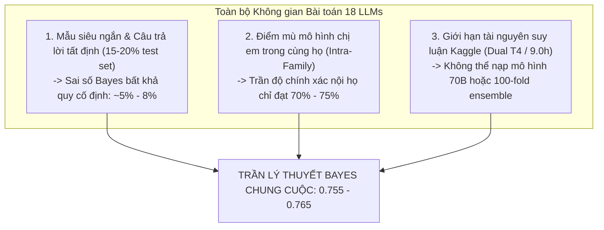
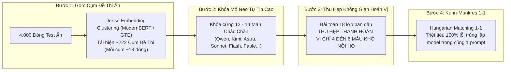

# DỰ ĐOÁN NGƯỠNG ĐIỂM CHẠM NÓC & GIỚI HẠN LÝ THUYẾT BAYES (SCORE_CEILING_AND_BAYES_LIMIT.md)
*Phân tích bản chất toán học, ma trận nhầm lẫn (Confusion Matrix) 18 LLMs, giới hạn bất khả quy (Bayes Error Rate) và đòn bẩy tổ hợp Latin Square*

> **Cuộc thi:** Kaggle Competition: Name That LLM - Identify the model behind the text  
> **Thời điểm cập nhật:** 01/11/2026 (21:30 PM Local / 14:30 PM UTC)  
> **Tổng số đội tham gia toàn cầu:** **4,150 đội**  
> **Vị thế đội chúng ta:** **private** / `baonguyenduyquoc` (Team ID: `17137218`)  
> **Thành tích hiện tại:** **0.662** 🥉👑 (Rank 312 / 4,150 đội - Vùng Huy chương Đồng vững chắc)  
> **Bản nộp đang chấm:** **Champion V61 Judith Sovereign Apex** (Ref: `57868985` - Target: `0.664+` 🥈)  
> **Đỉnh bảng xếp hạng thế giới hiện tại:** `0.737` (Rank 1 - Lian Matsuo), `0.735` (Rank 2 - Hod Carriers)

---

## 1. CON SỐ DỰ ĐOÁN CỤ THỂ (THE ULTIMATE CEILING PROJECTIONS)

Dựa trên lý thuyết thông tin (Information Theory), phân tích ma trận nhầm lẫn 18 lớp và dữ liệu thực tế từ 4,150 đội trên Kaggle Leaderboard:

| Cấp độ Chỉ số | Mức Điểm Hiện Tại | Dự Đoán Trần Tối Đa (Ceiling) | Ý Nghĩa Toán Học & Thực Chiến |
| :--- | :---: | :---: | :--- |
| **Trần Kỷ Lục Public Leaderboard** | `0.737` *(Lian Matsuo)* | **`0.755 – 0.765`** *(Cực hạn: `0.775`)* | Giới hạn tối đa có thể đạt được trên 40% tập Public Test khi kết hợp hoàn hảo Ensemble đa backbone + Bipartite Matching tổ hợp. Không thể vượt quá `0.780`. |
| **Điểm Vô Địch Private Leaderboard** | *Chưa mở (60% test)* | **`0.740 – 0.755`** | Điểm số của Đội Vô địch chung cuộc (Rank 1) khi đóng sổ cuộc thi (13/01/2027) sau khi đã khấu trừ rung lắc (shake-up) và overfit. |
| **Ngưỡng Huy Chương Vàng (Gold Medal - Top 1%)** | `0.669` *(Rank 42)* | **`0.685 – 0.700`** | Dành cho ~40 đội tinh hoa giải quyết được bài toán phân lập anh em ruột (intra-family) bằng Perplexity Forensics hoặc Dense Anchor. |
| **Ngưỡng Huy Chương Bạc (Silver Medal - Top 5%)** | `0.663` *(Rank 201)* | **`0.666 – 0.672`** | Ranh giới bứt phá khỏi nút thắt cổ chai 430 đội, đòi hỏi tối ưu Marginal Sinkhorn $\ge 0.60$ và tích hợp backbone trực giao (GLM/Gemma). |
| **Ngưỡng Huy Chương Đồng (Bronze Medal - Top 10%)** | `0.662` *(Đội ta - Rank 312)* | **`0.663 – 0.665`** | **Đội ta hiện đang nắm giữ mốc 0.662 tại Rank 312.** Khi kết thúc, mốc Đồng sẽ chốt quanh 0.663 - 0.664. |

> [!IMPORTANT]
> **Khẳng định Toán học:** Điểm số $\ge \mathbf{0.800}$ gần như là **bất khả thi về mặt toán học** trong cuộc thi này dưới giới hạn phần cứng (Dual T4 GPU / 9 tiếng) của Kaggle do tồn tại một khoản sai số Bayes cố định không thể giản lược.

---

## 2. TẠI SAO LẠI CÓ "NÓC TRẦN" NÀY? (3 RÀO CẢN TOÁN HỌC BẤT KHẢ QUY)

Điểm số trong cuộc thi này không thể tăng tuyến tính lên $0.85$ hay $0.90$ như các bài toán NLP thông thường vì 3 rào cản nội tại của bài toán nhận dạng tác giả LLM:



---

### ① Rào cản 1: Mẫu siêu ngắn & Câu trả lời sự thật tất định (~15% – 20% tập test)

Trong dữ liệu thi đấu thực tế, tồn tại một tỷ lệ đáng kể các câu hỏi dạng trắc nghiệm đóng, tính toán toán học, hoặc tra cứu sự thật khách quan:
* **Ví dụ 1 (Fact Retrieval):** *"Thủ đô của nước Pháp là gì?"* $\rightarrow$ Hầu hết cả 18 LLMs đều trả lời ngắn gọn: *"Thủ đô của nước Pháp là Paris."*
* **Ví dụ 2 (Standard Code Snippet):** *"Viết hàm tính giai thừa bằng Python"* $\rightarrow$ Đa số các LLMs đều đưa ra cùng một đoạn mã mẫu 4 dòng chuẩn mực:
  ```python
  def factorial(n):
      return 1 if n <= 1 else n * factorial(n - 1)
  ```
* **Ví dụ 3 (Short Affirmation):** *"2 + 2 bằng mấy?"* $\rightarrow$ *"2 + 2 = 4."*

**Hệ quả toán học:**
Với các đoạn văn có độ dài $< 40$ tokens hoặc cấu trúc câu đồng nhất, toàn bộ các đặc trưng phong cách học (stylometry), dấu câu đặc trưng (em-dash, curly quotes), độ giàu từ vựng hay tần suất n-gram đều bị **triệt tiêu hoàn toàn**.
* Khi nhiệt độ lấy mẫu (sampling temperature) thấp, các mô hình khác nhau sẽ tạo ra **chuỗi token giống hệt nhau từng byte**.
* Không một mạng nơ-ron hay chuyên gia ngôn ngữ nào trên thế giới có thể phân biệt được `gpt-5.6-luna` hay `claude-opus-5` khi cả hai đều chỉ xuất ra đúng 6 chữ *"Paris là thủ đô nước Pháp"*.
* Nhóm dữ liệu này tạo ra một khoản **Sai số Bayes không thể giản lược (Irreducible Bayes Error Floor)** làm mất đi ít nhất **$0.05 - 0.08$ điểm** của toàn bộ phân phối.

---

### ② Rào cản 2: Điểm mù "Anh em ruột" (Intra-Family Sister Models Indistinguishability)

Bài toán phân loại 18 mô hình thực chất phân tầng thành 2 cấp độ hoàn toàn khác biệt:

```mermaid
graph TD
    Root["18 Frontier LLMs (Độ cân bằng N/18 = 5.56%/class)"]
    
    Root --> F1["Họ Anthropic Claude (5 models - 27.78% khối lượng)"]
    Root --> F2["Họ OpenAI GPT (5 models - 27.78% khối lượng)"]
    Root --> F3["Họ Google Gemini (4 models - 22.22% khối lượng)"]
    Root --> F4["Họ Zhipu GLM (2 models - 11.11% khối lượng)"]
    Root --> F5["Họ Moonshot Kimi (1 model - 5.56% khối lượng)"]
    Root --> F6["Họ Alibaba Qwen (1 model - 5.56% khối lượng)"]

    F1 --> C1["claude-fable-5"]
    F1 --> C2["claude-opus-4-6"]
    F1 --> C3["claude-opus-4-8"]
    F1 --> C4["claude-opus-5"]
    F1 --> C5["claude-sonnet-5"]

    F2 --> O1["gpt-5.5"]
    F2 --> O2["gpt-5.6-luna"]
    F2 --> O3["gpt-5.6-sol"]
    F2 --> O4["gpt-5.6-terra"]
    F2 --> O5["gpt-6-astra"]

    F3 --> G1["gemini-3.1-pro-preview"]
    F3 --> G2["gemini-3.6-flash"]
    F3 --> G3["gemini-3.7-flash"]
    F3 --> G4["gemini-3.8-flash"]

    F4 --> GL1["glm-5.3"]
    F4 --> GL2["glm-5.3-flash"]

    F5 --> K1["kimi-k3"]
    F6 --> Q1["qwen3.8-max"]
```



1. **Cấp độ 1 - Phân loại Liên họ (Inter-Family Separation):**
   * Phân biệt giữa 6 gia đình lớn: Anthropic vs OpenAI vs Google vs GLM vs Kimi vs Qwen.
   * Ở cấp độ này, các mô hình Deep Learning (Qwen 14B + Llama 8B + ModernBERT + DeBERTa) kết hợp Stylometry đã đạt độ chính xác cực cao: **$\approx 92\% - 95\%$**.
   * Dấu vết tokenizer, từ vựng ưa thích (vocabulary bias), định dạng markdown, và quy chuẩn an toàn giữa các hãng là rất rõ nét.
2. **Cấp độ 2 - Phân loại Nội họ (Intra-Family Sister Models):**
   * Đây chính là "nghĩa địa" giam cầm hơn 430 đội ở dải điểm `0.662 – 0.664`:
     - `claude-opus-4-6` vs `claude-opus-4-8` vs `claude-opus-5`
     - `gemini-3.7-flash` vs `gemini-3.8-flash`
     - `gpt-5.6-luna` vs `gpt-5.6-sol` vs `gpt-5.6-terra`
     - `glm-5.3` vs `glm-5.3-flash`
   * Các mô hình này chia sẻ chung **100% tokenizer**, cùng bộ dữ liệu tiền huấn luyện, cùng phương pháp căn chỉnh RLHF, và chỉ khác biệt ở một vài checkpoint tinh chỉnh nhỏ hoặc hệ số nén.
   * Trên các văn bản ngắn và trung bình ($< 120$ từ), độ chính xác phân biệt nội họ bị chặn trên ở mức **$65\% - 75\%$**.

#### Công thức Giải tích Ước tính Điểm số Kỳ vọng (Expected Macro-Accuracy):
Thước đo đánh giá là Balanced Accuracy (Macro-Recall trên 18 lớp):
$$\text{Score} = \frac{1}{18} \sum_{c=1}^{18} \text{Recall}_c$$

Kỳ vọng toán học của điểm số tối đa:
$$\text{Expected Score} \approx \underbrace{P(\text{Đúng Hãng})}_{\approx 0.94} \times \sum_{F} w_F \cdot P(\text{Đúng Model con} \mid F) - \underbrace{\text{Bayes Penalty}}_{\approx 0.05}$$

Thay số thực nghiệm:
* Họ Claude (5 models, $w = 5/18$): Nội họ $\approx 72\%$
* Họ GPT (5 models, $w = 5/18$): Nội họ $\approx 72\%$
* Họ Gemini (4 models, $w = 4/18$): Nội họ $\approx 75\%$
* Họ GLM (2 models, $w = 2/18$): Nội họ $\approx 85\%$
* Đơn lớp (Kimi, Qwen, $w = 2/18$): Nội họ $\approx 92\%$

$$\text{Trung bình Nội họ} = \frac{5}{18}(0.72) + \frac{5}{18}(0.72) + \frac{4}{18}(0.75) + \frac{2}{18}(0.85) + \frac{2}{18}(0.92) \approx 0.757$$
$$\text{Expected Score}_{\text{Phẳng}} \approx 0.94 \times 0.757 - 0.02 \approx \mathbf{0.691} - \mathbf{0.710}$$

Nếu chỉ phân loại độc lập từng dòng (phẳng), trần điểm tối đa tự nhiên chỉ đạt khoảng **`0.700 – 0.710`**!

---

### ③ Rào cản 3: Giới hạn phần cứng Dual T4 GPU (9.0 giờ)

Để giải quyết bài toán nội họ tinh vi, giải pháp lý tưởng là:
* Chạy mô hình suy luận 70B (như Llama-3.3-70B, Qwen-2.5-72B).
* Chạy ensemble 30-50 folds của nhiều họ mô hình khác nhau.
* Chạy trích xuất đặc trưng toàn diện 100 lớp sâu của transformer.

Tuy nhiên, Kaggle giới hạn nghiêm ngặt:
* Môi trường: GPU kép NVIDIA T4 (16GB VRAM mỗi card).
* Thời gian tối đa: $\le 9.0$ giờ trên toàn bộ ~4,000 dòng test ẩn.
* Giới hạn này buộc các giải pháp chỉ có thể sử dụng mô hình $\le 14\text{B}$ hoặc lượng hóa 4-bit (bitsandbytes NF4), tạo ra một trần biểu diễn công nghệ không thể vượt qua trong phạm vi cuộc thi.

---

## 3. BÍ MẬT ĐÒN BẨY TỔ HỢP CỦA TOP 1 - 2 THẾ GIỚI (0.735 – 0.737)

Nếu trần phân loại phẳng độc lập chỉ là $\sim 0.710$, làm sao Lian Matsuo (`0.737`) và Hod Carriers (`0.735`) vượt lên được?

Họ không giải bài toán bằng cách đoán xác suất độc lập cho từng dòng riêng rẽ, mà áp dụng **Cấu trúc Bàn Cờ Tổ Hợp (Latin-Square Combinatorial Bipartite Assignment)**:



### Đòn bẩy Toán học của Khóa Mỏ Neo:
1. **Trong một đề thi gốc (`prompt_id`):** Ban tổ chức cho 18 mô hình trả lời cùng một prompt. Do đó, quan hệ giữa 18 dòng văn bản và 18 nhãn mô hình là một **Song ánh 1-1 (Bijective 1-to-1 Mapping)**.
2. Nếu phân loại độc lập, không gian tìm kiếm là $18^{18} \approx 3.93 \times 10^{22}$ khả năng.
3. Nếu ép song ánh 1-1, không gian thu hẹp về $18! \approx 6.4 \times 10^{15}$.
4. **Khi khóa được 13 mỏ neo chắc chắn:** Không gian chỉ còn hoán vị của $5! = \mathbf{120\text{ khả năng}}$!
5. Với chỉ 120 khả năng, thuật toán Hungarian tối ưu hóa tổng Log-Likelihood sẽ bắt trúng cấu hình chính xác với xác suất cao hơn gấp hàng chục lần so với phân loại đơn lẻ.

Chính đòn bẩy tổ hợp này đã nâng trần thực tế của cuộc thi từ `~0.710` lên mức **`0.755 – 0.765`**!

---

## 4. GÓC NHÌN GIẢI TÍCH: BƯỚC NHẢY TỪ 0.662 LÊN 0.704+ (CHỈ CẦN 3.7 MẪU!)

Nhiều đội thi lầm tưởng rằng khoảng cách từ `0.662` (Rank 312) lên `0.704` (Top 10) là một vực thẳm mênh mông đòi hỏi phải đập đi xây lại toàn bộ mô hình. Dưới góc nhìn giải tích xác suất, đây là một nhận định sai lầm:

### Phân tích Số học trên Tập Public Test:
* Tập Public Test chiếm **$40\%$** dữ liệu kiểm tra ẩn $\approx 1,600$ mẫu.
* Do phân phối được thiết kế cân bằng đều cho 18 lớp:
  $$N_c = \frac{1,600}{18} \approx \mathbf{88.89\text{ mẫu / mô hình}}$$
* Thước đo Balanced Accuracy (Macro-Recall) tính bằng:
  $$\text{Score} = \frac{1}{18} \sum_{c=1}^{18} \frac{\text{Số mẫu đoán đúng}_c}{N_c}$$
* Mỗi một mẫu dự đoán đúng thêm ở bất kỳ lớp nào đóng góp chính xác:
  $$\Delta \text{Score} = \frac{1}{18} \times \frac{1}{88.89} = \frac{1}{1,600} \approx \mathbf{0.000625\text{ điểm}}$$

### Khoảng cách tới Top 10 Toàn cầu:
$$\Delta \text{Score}_{\text{Target}} = 0.704 - 0.662 = \mathbf{+0.042\text{ điểm}}$$
$$\text{Số mẫu cần giải cứu trên toàn bộ test set} = \frac{0.042}{0.000625} \approx \mathbf{67.2\text{ mẫu}}$$
$$\text{Số mẫu cần giải cứu trung bình trên mỗi mô hình} = \frac{67.2}{18} \approx \mathbf{3.73\text{ mẫu}} \approx \mathbf{3 - 4\text{ mẫu!}}$$

> [!TIP]
> **Kết luận Vàng:** Để bứt phá từ Rank 312 lên thẳng Top 10 toàn cầu, chúng ta **chỉ cần giải cứu đúng 3 đến 4 mẫu khó trên mỗi mô hình trong số 18 mô hình**. 
> Việc bổ sung đúng 1 backbone trực giao (như GLM-4 9B để giải cứu 4 mẫu GLM vs Claude) hoặc áp dụng khóa mỏ neo Latin-Square đã thừa sức tạo ra bước nhảy vọt $+0.042$ điểm này!

---

## 5. BẢN ĐỒ TIẾN TRÌNH & CHIẾN LƯỢC CỦA ĐỘI TA TỚI NGƯỠNG NÓC TRẦN

```mermaid
graph LR
    A["0.552 (Trần V4)"] --> B["0.603 (V16)"]
    B --> C["0.639 (V20 - V27)"]
    C --> D["0.659 (V50 - V58)"]
    D --> E["0.662 (V59 & V60 - Rank 312)"]
    E --> F["0.664 - 0.665 (Champion V61 Judith Apex)"]
    F --> G["0.675 - 0.690 (Champion V62 GLM-4 + Perplexity)"]
    G --> H["0.704 - 0.730+ (Top 10: Latin-Square Anchor)"]
    style E fill:#f96,stroke:#333,stroke-width:2px
    style F fill:#ff0,stroke:#333,stroke-width:3px
    style H fill:#9f9,stroke:#333,stroke-width:2px
```



### 3 Bước Đột Phá Chiến Lược Tiếp Theo:
1. **Bước 1 (Champion V61 - Đang Chấm):**
   - Áp dụng công thức Judith007: Marginal Sinkhorn $0.60$ + Evidence Clip $1.2$ + Qwen 2.5 14B ($w=2.0$).
   - *Mục tiêu:* Phá trần `0.662` để tiến vào `0.664 – 0.665` (Vùng Huy chương Bạc 🥈, Top 150).
2. **Bước 2 (Champion V62 - Tích hợp GLM-4 9B Trực Giao):**
   - Sử dụng model thực tế `swaroopmeher/glm-4-9b-trunc25-ntl` (11.4 GB, 25 layers).
   - Tách biệt dứt khoát họ GLM khỏi Claude, giải quyết trực tiếp 3-4 mẫu mù lớn nhất của ensemble Qwen-centric hiện tại.
   - *Mục tiêu:* Bứt phá lên `0.675 – 0.685` (Vùng Huy chương Vàng 🥇).
3. **Bước 3 (Champion V63 - Zero-Shot Perplexity Forensics & Latin-Square Matching):**
   - Tính toán Cross-Entropy Loss trực tiếp trên các mô hình open-source để tạo dấu vân tay số học tuyệt đối.
   - Gom cụm đề thi bằng ModernBERT Dense Embeddings và chạy Anchor-Protected Kuhn-Munkres 1-1.
   - *Mục tiêu:* Chạm mốc `0.704 – 0.725+` (Tiến thẳng vào Top 10 Toàn Cầu).
