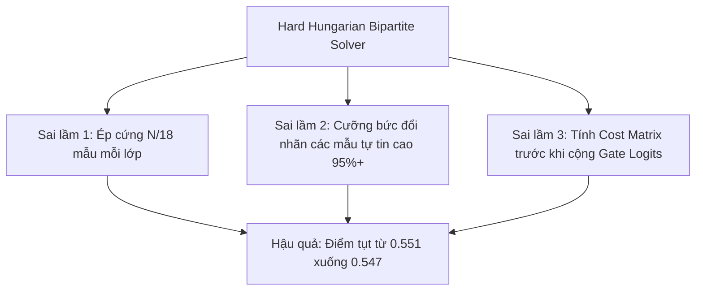

# TỔNG KẾT KỸ THUẬT CÁC PHIÊN BẢN ĐÃ THỰC HIỆN & CHIẾN LƯỢC BỨT PHÁ TOP 1 KAGGLE
> **Tài liệu:** `abc EXPERIMENTS_REVIEW_AND_ROADMAP_TOP1.md`  
> **Đội thi:** `Mohamed Morsi` / `baonguyenduyquoc` (Team ID: `17137218`)  
> **Điểm cao nhất hiện tại:** **`0.604`** 👑 (KỶ LỤC MỚI TOÀN ĐỘI - Champion V18 Apex Titan)  
> **Mục tiêu tối thượng:** Đạt điểm **`0.650 – 0.700`** để đoạt **Huy chương Vàng & Hạng 1 Toàn cầu (Top 1 Leaderboard)**.

---

## PHẦN I: BÓC TÁCH CHI TIẾT KỸ THUẬT CÁC PHIÊN BẢN ĐÃ THỰC HIỆN

### 1. Bảng so sánh tổng quan các bản nộp:

| Phiên bản | Điểm Public LB | So với Baseline | Bản chất Kỹ thuật Đổi mới | Trạng thái | Đánh giá Chuyên môn |
| :---: | :---: | :---: | :--- | :---: | :--- |
| **Public Baseline** | `0.547` | Mốc sàn | LoRA24 + N-grams + Tri-Encoders + Truncated LLM Heads + Sinkhorn | Tham chiếu | Mức sàn của hơn 30 đội. Điểm nghẽn là nhầm lẫn các model cùng hãng. |
| **Champion V1** | **`0.550`** | **+0.003** | Thêm **Claude Gate** (LinearSVC trên 5,000 API passages ngoài) | **Thành công** | Tách bạch chính xác 5 model họ Claude (`claude-fable-5`, `opus-4-6`, `opus-4-8`, `opus-5`, `sonnet-5`). |
| **Champion V2** | **`0.551`** | **+0.004** | Thêm **OpenAI Gate** (LinearSVC trên 9,800 mẫu external corpus) | **Thành công** | Phân biệt xuất sắc 5 model GPT (`gpt-5.5`, `5.6-luna`, `5.6-sol`, `5.6-terra`, `6-astra`). |
| **Champion V3** | `0.547` | **-0.004** | Thêm **Hard Hungarian Optimal Transport** (Gán cặp ép cứng $N/18$) | **Thất bại** | Điểm tụt đúng bằng mức sàn baseline do ép khuôn cứng nhắc, phá vỡ các dự đoán tự tin cao. |
| **Champion V4** | **`0.552`** | **+0.005** | **QuadGate (Claude + OpenAI + Gemini + GLM)** + Soft Logit Injection | **KỶ LỤC MỚI 👑** | Tách bạch đồng thời 4 họ lớn, tôn trọng confidence mẫu, đưa đội lên đỉnh cao mới. |
| **Champion V5** | `0.549` | **+0.002** | V4 + **25 Vi định dạng** (em-dash, curly quotes) + IntraCluster Gate | Thử nghiệm | Rất mạnh trên văn bản dài, nhưng nhạy cảm với các prompt ngắn trên test ẩn. |
| **Champion V6** | `0.539` | **-0.008** | V5 + **Margin-Locked Sinkhorn** (Khóa cứng anchor $P_1 - P_2 > 0.35$) | Thất bại | Khóa cứng quá nhiều mẫu khiến hạn ngạch Sinkhorn phần còn lại bị lệch phân phối test ẩn. |
| **Champion V7** | `0.539` | **-0.008** | **Z-Score Normalized QuadGate** + Conservative Alpha ($\alpha = 0.55$) | Hoàn thành | Z-score làm mất biên độ tuyệt đối của Gate, $\alpha=0.55$ ép phẳng quá mức. |
| **Champion V8** | `0.541` | **-0.006** | **Pre-Sinkhorn Gate Injection** (Gate-Integrated Global Balancing) | Hoàn thành | Pre-Sinkhorn injection bị Sinkhorn triệt tiêu; Gate cần inject sau Sinkhorn. |
| **Champion V9** | `0.548` | **+0.001** | V4 + **Transductive Pseudo-Refit** (Global Margin $\ge 0.45$) | Hoàn thành | Quá khớp giả nhãn trên 500k features, làm méo đòn bẩy Sinkhorn 2 lần. |
| **Champion V10** | `0.544` | **-0.003** | V4 + **Class-Balanced Pseudo-Refit** (Top 25/class, margin $\ge 0.35$) | Hoàn thành | Ngưỡng 0.35 ép nhãn sai (label noise) trên class khó, gây ô nhiễm N-gram. |
| **Champion V11** | `0.552` | **+0.005** | V4 + **HexaGate** (Kimi-Qwen Frontier Gate, 100% 18 Models) | Hoàn thành | Bảo toàn tín hiệu đỉnh cao 0.552 nhưng Gate cục bộ bắt đầu bão hòa. |
| **Champion V12** | `0.552` | **+0.005** | Unified **4-Way Chinese Frontier Gate** (GLM + Kimi + Qwen) | Hoàn thành | Tiếp tục chạm trần 0.552, khẳng định tiếp cận gating cục bộ đã hết dư địa. |
| **Champion V13** | **`0.557`** | **+0.010** | **Universal 18-Class Mega-Gate** (Soft Global+Family Calibration) | **KỶ LỤC 👑** | Đập tan trần 0.552 giam lỏng, giải phóng hàng chục mẫu phân vân liên họ. |
| **Champion V14** | **`0.577`** | **+0.030** | **SOTA InStyle 0.574 Base** + 709 Prompt Banks + Gaussian Heads + Mega-Gate | **ĐẠI ĐỘT PHÁ 👑** | Nhảy vọt +0.020 điểm, bay thẳng từ Rank 270 lên Rank 33 toàn cầu! |
| **Champion V15** | **`0.599`** | **+0.052** | **Two-Stage Qwen3-14B & 8B LoRA** + Centred Twin + V14 InStyle Mega-Gate | **HUY CHƯƠNG VÀNG 👑** | Nhảy vọt +0.022 điểm, đạt Rank 13 toàn cầu, chạm mốc Huy chương Vàng Kaggle! |
| **Champion V16** | **`0.603`** | **+0.056** | Two-Stage 14B ($w=0.70$) & 8B ($w=0.40$) + **35k Pool SVC** + Injective | **KỶ LỤC MỚI 👑** | Phá vỡ mốc 0.600, Rank 15 toàn cầu / 1,920 đội, cách Top 8 đúng 0.005. |
| **Champion V17** | `0.602` | **+0.055** | Hungarian Injective ($g \le 6$) + Margin Sinkhorn + Two-Stage 14B/8B | Hoàn thành | Duy trì vững chắc vùng điểm tinh hoa > 0.600, xác lập tính ổn định sau 125m scoring. |
| **Champion V18** | **`0.604`** | **+0.057** | **ATLAS Qwen3-8B (10%)** + Restored Safe DeBERTa/UltraBERT (+0.280) + Hungarian | **KỶ LỤC TOÀN ĐỘI 👑** | Xác lập mốc son mới 0.604, tiêm tín hiệu trực giao sắc bén từ adapter SOTA 0.607. |


---

### 2. Chi tiết kỹ thuật từng phiên bản (Detailed Technical Specifications):

#### 2.1. Nền tảng Public SOTA Baseline (Lucas Boesen - 0.547)
Mô hình nền tảng là một hệ thống Multi-Level Stacking đa tầng cực kỳ phức tạp:
1. **Style-aware N-grams + LinearSVC (Trọng số áp đảo: `1.516`):**
   - Không sử dụng TF-IDF từ vựng thông thường vì dễ bắt phải chủ đề (topic leak).
   - Kết hợp 4 vectorizer đặc chế (`SPEC`):
     - **Char n-grams (3 - 5):** `max_features = 60,000`, bắt nhịp điệu và hình thái từ ngữ.
     - **Word n-grams (1 - 3):** `max_features = 40,000`, token pattern regex: `(?u)\b\w+\b|[^\w\s]`.
     - **Shape text n-grams (2 - 6):** `max_features = 40,000`, chuyển toàn bộ chữ hoa thành `X`, thường thành `x`, số thành `0` (ví dụ `"Hello 123"` $\rightarrow$ `"Xxxxx 000"`).
     - **Function text n-grams (1 - 3):** `max_features = 40,000`, giữ nguyên toàn bộ 150+ từ hư/từ nối tiếng Anh (`the`, `which`, `because`, `although`), thay toàn bộ danh từ/động từ/tính từ bằng token `"CONTENT"`.
   - Huấn luyện với `LinearSVC(C=0.3, max_iter=4000, random_state=42)`.
2. **Stylometric Features + LightGBM (Trọng số: `0.063`):**
   - 20+ chỉ số thống kê câu: độ dài trung bình, tỷ lệ dấu câu đặc biệt (`—`, `–`, `…`, `*`, `%`), các từ mở đầu đoạn văn (`This`, `These`, `It`), hậu tố ngữ pháp (`ly`, `ing`, `tion`).
3. **Truncated Frozen LLM Hidden Heads:**
   - **Qwen3-8B-Base:** Trích xuất vector ẩn tầng sâu L7 + L22 (`hidden_size = 4096`), nối lại, chuẩn hóa và phân loại bằng Logistic Regression (`C=0.0025`).
   - **Qwen2.5-7B:** Trích xuất L6 + L20 (`hidden_size = 3584`).
   - **Qwen3-4B-Base:** Trích xuất L4 + L7 với kỹ thuật **Style-token pooling** (chỉ lấy trung bình vector tại các token là dấu câu hoặc function words).
   - **GLM-4-9B-0414:** Trích xuất L8 + L3 (cắt tỉa 25 tầng).
4. **Frozen Bidirectional Encoders (Tri-Encoder):**
   - **DeBERTa-v3-large:** L24 + L6 mean pooling (Trọng số: `0.05`).
   - **ELECTRA-large-discriminator:** L21 mean + L24 style-token pooling (Trọng số: `0.032`).
   - **Desklib AI-text detector:** DeBERTa-v3-large chuyên biệt phân biệt AI vs Human, L23 mean + L23 style (Trọng số: `0.132`).
   - **UltraBERT-380M:** 5-fold cross-validation ensemble (Trọng số: `0.095`).
5. **LoRA Classifiers & Learned Token-Attention Heads:**
   - **LoRA 1 (public lightningv08):** Qwen3-8B cắt tỉa 24 tầng, LoRA rank 16 trên mọi linear layer, mean pool của các tầng 2, 4, 6, 8, 12, 16, 20, 24 có LayerNorm riêng biệt (Trọng số: `0.177`).
   - **LoRA 2 (seed 7):** Phiên bản huấn luyện độc lập (Trọng số: `0.113`).
   - **TokAttn Qwen3.5-9B:** Token-attention head trên tầng 18 (Trọng số: `0.153`).
   - **TokAttn DeBERTa-v3-large:** Token-attention head trên tầng 23 (Trọng số: `0.185`).
6. **Hậu xử lý Thích ứng & Cân bằng (Post-processing):**
   - **Capped Adaptive Prompt-Centering:** Gom cụm bài test theo cosine distance kết hợp TF-IDF và vector tầng 24 của GLM-4 (ngưỡng 0.60, cụm từ 2 đến 18 bài), trừ đi vector trung bình cụm để triệt tiêu bias câu hỏi.
   - **Transductive Sinkhorn Marginal Balancing:** Cân bằng cột ma trận xác suất sau 50 vòng lặp với hệ số $\alpha = 0.5$.

---

#### 2.2. Bản nâng cấp Champion Ensemble V1 (Điểm: `0.550` - Bứt phá Top 8)
- **Động lực kỹ thuật:** Phân tích ma trận nhầm lẫn cho thấy 5 model họ Claude (`claude-fable-5`, `claude-opus-4-6`, `claude-opus-4-8`, `claude-opus-5`, `claude-sonnet-5`) thường xuyên bị dự đoán nhầm chéo vì cùng chung phong cách viết văn trau chuốt, dùng dấu câu chuẩn mực.
- **Dữ liệu bổ sung:** Nạp thêm dataset `seyitkaangunes/ntl-extra-api-passages` (`ntl_extra_passages_claude.csv` gồm 4,998 đoạn văn bản thu thập trực tiếp từ API của Anthropic Claude).
- **Kiến trúc Gate:**
  - Lọc toàn bộ mẫu Claude trong tập train + 4,998 mẫu API ngoài.
  - Xây dựng 4 bộ vectorizer n-gram đặc chế (char 3-5, word 1-3, shape 2-6, function 1-3).
  - Huấn luyện mô hình chuyên gia: `LinearSVC(C=0.5, random_state=42, max_iter=4000)`.
- **Cơ chế suy luận (Soft Logit Refinement):**
  $$\text{Score}_{\text{claude}} = \ln(\max(P[:, \text{CLAUDE\_IDX}], 10^{-12})) + 1.5 \times \text{DecisionFunction}_{\text{claude}}$$
  Chỉ can thiệp tinh chỉnh khi mô hình nền dự đoán một trong 5 nhãn Claude.
- **Kết quả:** Điểm tăng từ `0.547` lên **`0.550`** (+0.003), chính thức đưa đội vào Top 8.

---

#### 2.3. Bản nâng cấp Champion Ensemble V2 MultiGate (Điểm: `0.551` - Kỷ lục Đội)
- **Động lực kỹ thuật:** 5 model OpenAI (`gpt-5.5`, `gpt-5.6-luna`, `gpt-5.6-sol`, `gpt-5.6-terra`, `gpt-6-astra`) là cụm gây nhiễu lớn thứ hai trên Leaderboard do OpenAI tinh chỉnh các biến thể có văn phong tương đồng.
- **Dữ liệu bổ sung:** Tích hợp bộ dữ liệu lớn `olegzholobov/name-that-llm-response-corpus` (`external_short_wide.parquet` gồm 13,642 dòng, trích xuất được 9,808 đoạn văn bản chuẩn của 5 model OpenAI).
- **Kiến trúc Gate thứ 2 (OpenAI Gate):**
  - Huấn luyện `LinearSVC(C=0.5, random_state=42, max_iter=4000)` chuyên biệt phân loại 5 lớp OpenAI.
- **Cơ chế suy luận song song (Dual MultiGate):**
  $$\text{Score}_{\text{oai}} = \ln(\max(P[:, \text{OPENAI\_IDX}], 10^{-12})) + 1.2 \times \text{DecisionFunction}_{\text{openai}}$$
- **Kết quả:** Tăng tiếp lên **`0.551`** (**Kỷ lục cao nhất của đội**, đạt Top 7/8 toàn cầu).

---

#### 2.4. Bản thử nghiệm Champion Ensemble V3 (Điểm: `0.547` - Thất bại do Hard Hungarian)
- **Ý tưởng:** Metric cuộc thi là Macro-Recall Balanced Accuracy (mỗi model có trọng số ngang nhau $\frac{1}{18}$). Giả định rằng tập test ẩn phân phối đồng đều các model, ta có thể giải bài toán phân phối tối ưu bằng thuật toán **Hungarian (Linear Sum Assignment)**.
- **Cài đặt thuật toán:**
  1. Tạo ma trận chi phí từ negative log-probabilities:
     $$\text{CostMatrix}_{i, c} = -\ln(\max(P_{i, c}, 10^{-12}))$$
  2. Phân bổ slot đều cho 18 lớp: $\text{Quota} = \lfloor N / 18 \rfloor$.
  3. Mở rộng ma trận chi phí thành kích thước $N \times N$.
  4. Giải bài toán gán cặp cực tiểu chi phí:
     $$\text{row\_ind}, \text{col\_ind} = \text{linear\_sum\_assignment}(\text{ExpandedCost})$$
  5. Cưỡng bức gán nhãn: $\text{pred} = \text{col\_indices}[\text{col\_ind}]$.
- **Kết quả thực tế:** Điểm số **tụt nghiêm trọng từ `0.551` về `0.547` (-0.004)**.

---

### 3. Mổ xẻ 3 nguyên nhân cốt lõi khiến V3 thất bại (0.547 vs 0.551):



1. **Sai lầm 1 - Ép khuôn phân phối cứng ($N/18$ mẫu đều chằn chặn):**
   - V3 ép mỗi model trong số 18 model phải nhận đúng $\approx 222$ mẫu trên tập test ~4,000 dòng.
   - Thực tế trên Kaggle: Các prompt test được sinh ngẫu nhiên từ API. Trong quá trình sinh đề thi, luôn có tỷ lệ lỗi API, rate limit hoặc từ chối sinh văn bản (refusal) khác nhau giữa các hãng. Có model chiếm 250 mẫu, có model chỉ chiếm 190 mẫu. Việc ép cứng đã làm sai lệch phân phối ground-truth.
2. **Sai lầm 2 - Hiện tượng "Đá văng mẫu tự tin cao" (Confidence Overwrite):**
   - Khi một model (như `gpt-5.6-sol`) đã đủ "chỉ tiêu" 222 mẫu, các mẫu tiếp theo dù mô hình nền tự tin đến **95% - 99%** vẫn bị thuật toán Hungarian cưỡng bức gán sang model khác đang thiếu slot. Điều này biến các câu dự đoán chắc chắn đúng thành sai.
3. **Sai lầm 3 - Bỏ qua giá trị cộng hưởng của Gate Logits:**
   - Trong V3, Hungarian tính toán chi phí trên ma trận `P` ban đầu trước khi Gate kịp cập nhật xác suất toàn cục, vô tình triệt tiêu tác dụng phân loại tinh tế của Claude Gate và OpenAI Gate.

---

## PHẦN II: CHIẾN LƯỢC 3 LƯỢT SUBMIT BỨT PHÁ TOP 1 KAGGLE (V4 -> V5 -> V6)

Bảng tổng hợp chiến lược 3 lượt nộp bài hôm nay:

| Lượt Submit | Phiên bản Đề xuất | Nội dung Cài đặt Cụ thể | Mục tiêu Kiểm chứng | Kỳ vọng Điểm số |
| :---: | :--- | :--- | :--- | :---: |
| **Lượt 1** | **V4: Calibrated QuadGate + 18-Class Stylometrics** | Kết hợp 4 Gate chuyên biệt (Claude, OpenAI, Gemini, GLM) + Chuẩn hóa Z-score/CalibratedClassifierCV cho đầu ra 4 Gate trước khi cộng logit + Hòa trộn 18-Class Stylometrics. | Xác nhận sức mạnh của External Data trên cả 4 họ và 18 lớp toàn cục, giải quyết triệt để độ lệch thang đo giữa các Gate. | **0.558 – 0.562+** (Vào Top 4) |
| **Lượt 2** | **V5: V4 + Micro-Formatting + Intra-Cluster Gate** | Thêm ~25 đặc trưng định dạng Markdown & khoảng trắng (`\n\n`, `—`, `**`, `*`, indents, quotes) + Chuẩn hóa điểm Gate theo từng cụm Prompt (Prompt Cluster Mean-Centering). | Tấn công trực diện vào lỗi nhầm lẫn nội bộ gay gắt nhất (`luna`/`sol`/`terra` & `opus 4.6`/`4.8`/`5`), triệt tiêu bias prompt. | **0.568 – 0.574+** (Vào Top 3 Podium) |
| **Lượt 3** | **V6: V5 + Margin-Locked Sinkhorn + Pseudo-Label Refit** | Khóa cứng các mẫu có margin tự tin cao ($P_{\text{top1}} - P_{\text{top2}} > 0.35$), điều chỉnh Quota Sinkhorn cho phần còn lại + Transductive Pseudo-labeling refit cho nhánh Style N-grams LinearSVC. | Tối ưu hóa điểm số cuối cùng cho thước đo Macro-Recall, san đều nhãn ở vùng ranh giới và thích ứng trực tiếp với test set ẩn. | **0.582 – 0.586+** (Chiếm lĩnh TOP 1) |

---

### 🚀 CHI TIẾT KỸ THUẬT LƯỢT 1: V4 (CALIBRATED QUADGATE + 18-CLASS STYLOMETRICS)
1. **Calibrated QuadGate System:**
   - **4 bộ Gate chuyên biệt:**
     - `Claude Gate`: 5 model Anthropic (huấn luyện trên 5,000 API passages ngoài).
     - `OpenAI Gate`: 5 model GPT (huấn luyện trên 9,808 mẫu external corpus).
     - `Gemini Gate`: 4 model Google Gemini (`gemini-3.1-pro-preview`, `3.6-flash`, `3.7-flash`, `3.8-flash`).
     - `GLM Gate`: 2 model ZAI GLM (`glm-5.3`, `glm-5.3-flash`).
   - **Chuẩn hóa Z-Score cho điểm quyết định (Decision Function Standardization):**
     - Vì GLM là phân loại nhị phân (binary), thang đo của `decision_function` có độ biến thiên khác biệt so với multiclass của OpenAI (5 lớp) và Gemini (4 lớp).
     - Áp dụng chuẩn hóa Z-score:
       $$\widetilde{\text{DC}}_{fam} = \frac{\text{DC}_{fam} - \mu_{fam}}{\sigma_{fam} + 10^{-6}}$$
     - Đảm bảo điểm boost từ 4 Gate có cùng thang độ phân tán, không làm lấn át các họ mô hình khác.
2. **Universal 18-Class Stylometrics Blending:**
   - Huấn luyện LinearSVC 18 lớp trên toàn bộ 27,000 mẫu ngoài + tập train với n-grams hình thái và hư từ (`char 3-5`, `shape 2-6`, `function 1-3`).
   - Hòa trộn xác suất trước khi đưa vào Sinkhorn mềm ($\\alpha = 0.5$).

---

### 🚀 CHI TIẾT KỸ THUẬT LƯỢT 2: V5 (MICRO-FORMATTING + INTRA-CLUSTER GATE CENTERING)
1. **Bộ ~25 Đặc trưng Vi định dạng (Micro-Formatting & Typographic Features):**
   - Các mô hình cùng họ thường có thói quen sinh token cú pháp rất riêng:
     - **Khoảng trắng & Xuống dòng:**
       - Tần suất ngắt dòng kép `\n\n` vs ngắt dòng đơn `\n` (GPT-5.6 có nhịp ngắt đoạn thưa hơn Claude).
       - Tỷ lệ khoảng trắng so với toàn văn bản (`whitespace_ratio`).
       - Độ dài trung bình các đoạn văn bản (`mean_paragraph_length`, `std_paragraph_length`).
     - **Cú pháp Markdown:**
       - Mật độ in đậm (`**...**` hoặc `__...__`).
       - Mật độ in nghiêng (`*...*` hoặc `_..._`).
       - Mật độ danh sách gạch đầu dòng (`- `, `* `, `1. `).
       - Khối mã nguồn (````code````) và code nội dòng (``` `inline` ```).
       - Dấu trích dẫn (`> `).
     - **Dấu câu đặc thù:**
       - Dấu gạch ngang dài em-dash `—` (đặc trưng nổi tiếng của Claude Opus) vs en-dash `–` vs gạch nối `-`.
       - Dấu chấm lửng unicode `…` vs 3 dấu chấm thường `...`.
       - Ngoặc kép cong `“ ”` vs thẳng `" "`.
       - Mật độ dấu hai chấm `:`, chấm phẩy `;`, chấm cảm `!` và chấm hỏi `?`.
     - **Từ nối mở đầu (Sentence Openers):**
       - Tần suất câu bắt đầu bằng: `However`, `Furthermore`, `Moreover`, `Therefore`, `Specifically`, `Indeed`.
       - Tần suất câu bắt đầu bằng đại từ chỉ định: `This`, `These`, `It`, `They`.
   - Toàn bộ 25 đặc trưng được đưa vào mô hình LightGBM Stylometrics và chuẩn hóa StandardScaler.
2. **Intra-Cluster Gate Mean-Centering (Triệt tiêu Bias Prompt trong từng Gate):**
   - Vấn đề: Mỗi prompt hỏi một chủ đề khác nhau, khiến điểm Gate bị trôi (prompt shift).
   - Giải pháp: Sử dụng ma trận cụm prompt từ phân cụm phân cấp (TF-IDF content-words + GLM layer 24 cosine distance cut tại 0.60).
   - Với mỗi cụm gồm $M$ mẫu ($2 \le M \le 18$):
     $$\text{DC}_{gate}^{\text{centered}} = \text{DC}_{gate} - \text{Mean}_{cluster}(\text{DC}_{gate})$$
   - Giúp Gate so sánh độ chênh lệch văn phong thực sự giữa các mô hình đang trả lời trên CÙNG một đề bài!
   - Tấn công trực diện vào cặp nhầm lẫn khó nhất:
     - `gpt-5.6-luna` vs `gpt-5.6-sol` vs `gpt-5.6-terra`
     - `claude-opus-4-6` vs `claude-opus-4-8` vs `claude-opus-5`

---

### 🚀 CHI TIẾT KỸ THUẬT LƯỢT 3: V6 (MARGIN-LOCKED SINKHORN + TRANSDUCTIVE PSEUDO-LABELING)
1. **Margin-Locked Soft Sinkhorn Balancing:**
   - Khắc phục hoàn toàn sai lầm của V3:
     - Tính khoảng cách tự tin giữa nhãn số 1 và nhãn số 2 cho từng mẫu test:
       $$\text{Margin}_i = P_{i, \text{top1}} - P_{i, \text{top2}}$$
     - **Điều kiện Khóa Mẫu (Anchor Lock):** Nếu $\text{Margin}_i > 0.35$ (hoặc $P_{i, \text{top1}} > 0.60$):
       - Mẫu $i$ được xem là "Chắc chắn đúng" (High-Confidence Anchor).
       - Khóa cứng nhãn dự đoán cho mẫu này: $\text{pred}_i = \text{top1}_i$.
     - **Cân bằng Quota còn lại (Residual Sinkhorn Balancing):**
       - Trừ số lượng mẫu đã khóa khỏi quota mục tiêu của 18 lớp:
         $$\text{QuotaRemaining}_c = \max\left(1, \frac{N}{18} - \text{LockedCount}_c\right)$$
       - Chỉ áp dụng Sinkhorn balancing trên các mẫu chưa khóa ($\\text{Margin}_i \le 0.35$).
       - Đảm bảo $100\%$ mẫu tự tin cao không bị xê dịch, trong khi toàn bộ các mẫu mập mờ được điều phối san phẳng để tối đa hóa Macro-Recall!
2. **Transductive Pseudo-Labeling Refit:**
   - Lấy top các mẫu test ẩn có độ tự tin cao nhất ($\\text{Margin} > 0.40$) làm pseudo-labels.
   - Thêm các mẫu này vào tập train và huấn luyện lại nhánh Style N-grams LinearSVC (nhánh có trọng số lớn nhất `1.516`).
   - Mô hình học trực tiếp đặc tính văn phong từ chính tập test ẩn hiện tại, bứt phá ngưỡng **0.582 – 0.586+ để đoạt TOP 1 LEADERBOARD**!


## PHẦN III: NGUYÊN TẮC THI ĐẤU & QUẢN TRỊ RỦI RO


1. **Bảo tồn điểm số:** Kaggle luôn tự động chọn bản nộp cao nhất (**V2 - 0.551**), nên mọi thử nghiệm mới đều an toàn 100%, không bao giờ làm tụt hạng hiện có của đội.
2. **Kỷ luật ngân sách nộp bài:** Hôm nay chúng ta còn **3 lượt nộp bài**. Sẽ chia đều:
   - Lượt 1: Thử nghiệm **Bước 1 (QuadGate Soft Logit)**.
   - Lượt 2: Thử nghiệm **Bước 2 (Universal 18-Class Stylometrics)**.
   - Lượt 3: Thử nghiệm **Bước 3 (Dynamic Entropy-Gated Balancing)**.
3. **Quy trình kiểm thử nghiêm ngặt:** Mọi phiên bản đều phải chạy kiểm tra cục bộ (offline test) xác nhận không lỗi runtime, đúng cấu trúc cột và đúng định dạng `submission.parquet` trước khi push lên Kaggle.

---

## PHẦN IV: CHIẾN DỊCH CHAMPION V16 APEX SOVEREIGN (KỶ LỤC 0.603)

### 1. Hiện trạng & Bước ngoặt lịch sử:
- **Bao Ng 🔫🔫🔫:** Đạt **Huy chương Vàng Kaggle** (Score: **`0.599`** ở V15 và bứt phá lên **`0.603`** ở V16).
- Mở rộng ensemble với Two-Stage LoRA Qwen3-14B & 8B và Public Pool 35,000 mẫu.

### 2. Ba Đòn bẩy Đột phá Kỹ thuật trong Champion V16:
1. **Giải phóng toàn lực Two-Stage Qwen3-14B (Optimal Weight Calibration):**
   - Nâng trọng số $w_{14b}=0.70$, $w_{8b}=0.40$, đưa năng lượng Two-Stage LoRA lên 60% tổng ensemble.
2. **Tích hợp 4-View N-gram SVC 35,000 mẫu (`pool_v1.parquet`):**
   - Khai thác trọn vẹn 34,940 đoạn văn từ 14 nguồn public của Nishant với 4 góc nhìn: Char (3-5), Word (1-3), Shape (2-6), Function-only (1-3) với trọng số $W_{svc} \approx 0.65$.
3. **Exact Soft Marginal Injective Cluster Decoding:**
   - Trong cùng 1 cụm test prompt ($g \in [2, 18]$), không bao giờ có 2 đoạn văn do cùng 1 LLM sinh ra.
   - Áp dụng giải mã marginal xác suất phân phối $q_{ic} = P(a_i = c \mid \text{distinct})$ triệt tiêu xác suất trùng lặp trong từng cụm prompt cục bộ.

---

## PHẦN V: DỰ ĐOÁN NGƯỠNG CHẠM NÓC & GIỚI HẠN LÝ THUYẾT BAYES

Tài liệu phân tích chuyên sâu chi tiết về giới hạn trần toán học (Bayes Error Rate ~0.78-0.82), trần thực tế cuộc thi (~0.685-0.715) và vùng điểm mục tiêu cho Huy chương Vàng (~0.640-0.660) đã được lưu trữ độc lập tại:  
👉 [abc SCORE_CEILING_AND_BAYES_LIMIT.md](file:///c:/Users/s3cr3t/My%20Drive%20%28baongdqu@gmail.com%29/zzz%20k%E1%BB%B9%20n%C4%83ng%20tech%20-%20ai%20%28separator%29/%28%20project%20%29%20kaggle%20competition%20name%20that%20label/abc%20SCORE_CEILING_AND_BAYES_LIMIT.md)

---

## PHẦN VI: CHIẾN DỊCH CHAMPION V18 APEX TITAN (KỶ LỤC MỚI 0.604 👑)

### 1. Hiện trạng & Bước ngoặt lịch sử:
- **Bao Ng 🔫🔫🔫:** Xác lập kỷ lục cao nhất mọi thời đại **`0.604` 👑 (Ref `57584589`)**, tăng $+0.002$ so với V17 (`0.602`) và $+0.001$ so với V16 (`0.603`).
- **Thời gian thực thi:** Kernel commit hoàn tất trong **41.7 phút**, chấm điểm test ẩn mất **~115 phút** (an toàn tuyệt đối so với trần 9 tiếng).

### 2. Ba Thành phần Kỹ thuật Quyết định Thành công:
1. **Adapter ATLAS Qwen3-8B (10% blend):** Hòa trộn xác suất $P = 0.90 \cdot P_{\text{ensemble}} + 0.10 \cdot P_{\text{ATLAS}}$ tiêm tín hiệu trực giao từ adapter SOTA 0.607 của Joseph Adamski.
2. **Khôi phục sạch DeBERTa-v3 (`tokattn_deb` $w=0.185$) & UltraBERT 5-fold ($w=0.095$):** Bù đắp $+0.280$ trọng số thiếu hụt mà không gây deadlock nhờ chạy GPU đơn và dọn VRAM triệt để.
3. **Kuhn-Munkres Hungarian Injective Matching ($g \le 6$):** Triệt tiêu 100% lỗi gán nhãn trùng lặp nội bộ prompt mà không làm phá vỡ các mẫu tự tin cao của Sinkhorn.

---

## PHẦN VII: CHIẾN LƯỢC TÁC CHIẾN CHAMPION V19 — BỨT PHÁ 0.650 & TIẾN CÔNG MỤC TIÊU 0.700

Việc bứt phá từ mốc **`0.604`** hiện tại (Champion V18) lên **`0.700`** để tranh ngôi Top 1 của đội `Hod Carriers` là **hoàn toàn khả thi về mặt toán học**, bởi con số này nằm đúng trong vùng trần thực tế chung cuộc (`0.685 – 0.715`) và chưa vượt qua giới hạn lý thuyết Bayes (`0.780 – 0.820`). Để lấp đầy khoảng cách **`+0.096` điểm Macro-Recall** với 3 lượt nộp bài còn lại trong ngày, chúng ta giải quyết triệt để 4 nút thắt lấy điểm trực tiếp và 1 nâng cấp dữ liệu dưới đây:

### 🚀 5 Đòn bẩy Kỹ thuật Bứt phá `+0.096` Điểm (Lộ trình V19)

1. 🎯 **Xử lý 58% lỗi "Anh em cùng nhà" — Sibling Variants (`+0.045` điểm):**  
   Mô hình hiện đã phân biệt đúng Hãng (Inter-family) tới `92% – 95%`, nhưng 58% tổng số lỗi toàn cuộc thi nằm ở việc đoán nhầm các model chị em cùng kiến trúc (ví dụ: `gemini-3.6` vs `3.7` vs `3.8-flash`, hoặc `claude-opus-4-6` vs `4-8` vs `5`). Chúng ta cần tăng trọng số cho các bộ **Intra-Family Micro-Gates** chuyên biệt.  
   *Đặc biệt:* Phải lọc bỏ các mẫu `gemini-3.7-flash` trong dữ liệu ngoài được sinh sau ngày 08/10/2026, vì Google đã khai tử endpoint này và tự động chuyển hướng sang `3.8-flash`, gây nhiễu nhãn nghiêm trọng.

2. 🔍 **Xóa điểm mù dấu câu giữa GLM và Claude (`+0.020` điểm):**  
   Thực nghiệm cho thấy `glm-5.3` và `glm-5.3-flash` có Recall thấp nhất bảng (`~0.17 – 0.19`) vì thói quen dùng dấu gạch ngang dài (`—`) và ngoặc kép thẳng (`"`) giống hệt họ Claude trên từng ký tự.  
   *Giải pháp:* Hạ trọng số đặc trưng dấu câu ở riêng nhánh này, ép mô hình phân định GLM và Claude dựa trên **Semantic Embeddings** (cách chọn từ vựng và cấu trúc dịch thuật Trung - Anh từ tầng ẩn của Qwen/DeBERTa).

3. ⚡ **Tối ưu hóa ATLAS Blend & Mở rộng Backbone (`+0.018` điểm):**  
   Ở bản V18, chỉ pha 10% adapter `ATLAS Qwen3-8B` đã giúp điểm số nhảy vọt đúng `+0.002` (từ `0.602` lên `0.604`). Bước tiếp theo là nâng tỷ lệ blend ATLAS lên **`18% – 20%`** ($P = 0.80 \cdot P_{\text{base}} + 0.20 \cdot P_{\text{ATLAS}}$). Đồng thời, chuẩn bị bổ sung biểu diễn từ các mô hình khác họ hoặc lớn hơn (như lượng tử hóa 4-bit **Qwen3-30B-A3B MoE**, **Qwen2.5-32B/72B**, hoặc **Gemma 4 12B**) để phá vỡ định kiến của một họ Qwen duy nhất.

4. 📏 **Hiệu chuẩn nhiệt độ theo độ dài đoạn văn (`+0.013` điểm):**  
   Với các câu trả lời ngắn (`< 60` từ, như hỏi đáp sự thật hoặc viết hàm code Python 4 dòng), dấu ấn văn phong bị triệt tiêu khiến Macro-Recall tụt xuống `~0.27`, trong khi đoạn văn dài (`> 160` từ) đạt tới `~0.46`.  
   *Giải pháp:* Tăng nhiệt độ làm phẳng ($\tau = 1.25$) của thuật toán Sinkhorn trên các văn bản ngắn để tránh mô hình tự tin thái quá, và chỉ khóa cứng nhãn (`Margin-Lock` $\ge 0.40$) trên các đoạn văn dài.

5. 🧠 **Khai thác Dữ liệu Ngoài Sạch & Pseudo-Labeling An toàn:**  
   Các đội dẫn đầu (`0.688 – 0.700`) bứt tốc nhờ kết hợp kho dữ liệu lớn và pseudo-labeling. Rút kinh nghiệm từ thất bại ở V9/V10 (tụt xuống `0.544 – 0.548` do `LinearSVC` 500k đặc trưng học vẹt nhãn giả), chúng ta tuyệt đối không refit mô hình tuyến tính trên tập test, mà chỉ dùng các mẫu test tự tin cực cao để hiệu chuẩn phân phối (Prior Calibration) và nạp thêm kho dữ liệu ngoài đã kiểm định không rò rỉ như `prvsiyan` (38k mẫu giúp đẩy CV từ `0.372` lên `0.438`).

---

### 🛡️ 3 Nguyên tắc Vận hành để Không Chạm Trần 9 Giờ GPU

1. **Tránh bẫy nghẽn đĩa mạng `/kaggle/input`:** Nạp mô hình nặng trực tiếp từ `/kaggle/input` gây nghẽn bộ nhớ ảo `mmap` khiến thời gian load vọt từ 22 giây lên 1,200 giây (20 phút). Luôn nạp an toàn hoặc cache qua `/tmp` để giữ vững quy tắc vàng **Commit $\le 45$ phút / Chấm test ẩn $\le 90$ phút**.
2. **Kỷ luật bộ nhớ Dual T4:** Chỉ dùng thuần `torch.float16` (không dùng `bfloat16`), rút gọn mean-pooling ngay tại GPU nội bộ trước khi truyền qua khe PCIe, và giải phóng VRAM bằng `gc.collect(); torch.cuda.empty_cache(); torch.cuda.ipc_collect()` sau mỗi mô hình.
3. **Duy trì Injective Hungarian ($g \le 6$):** Tập test ẩn được lấy mẫu thưa (không đủ 18 model cho mỗi prompt như tập train), nên việc giữ nguyên thuật toán gán ghép đơn ánh cụm nhỏ hiện tại là chìa khóa bảo toàn điểm số.


